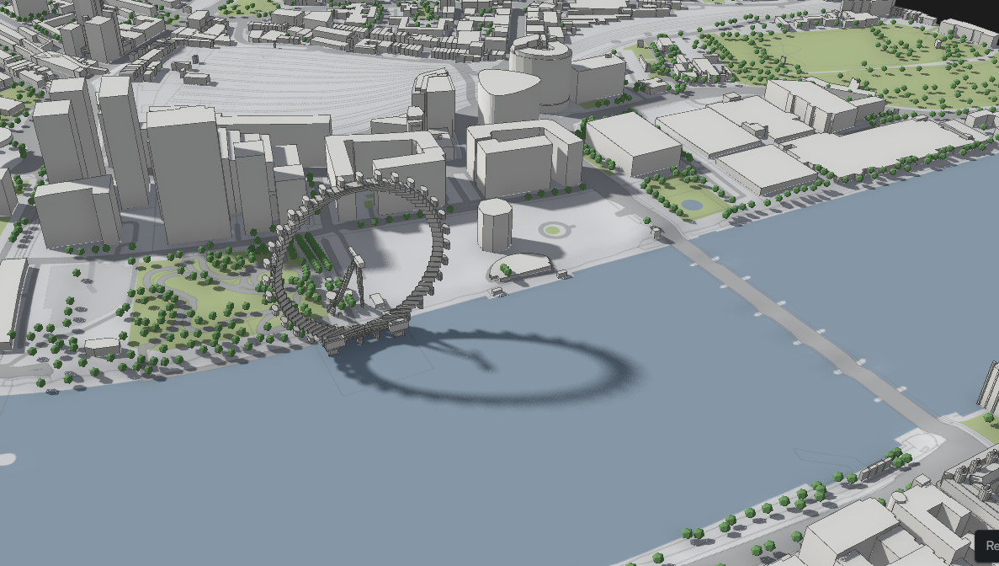
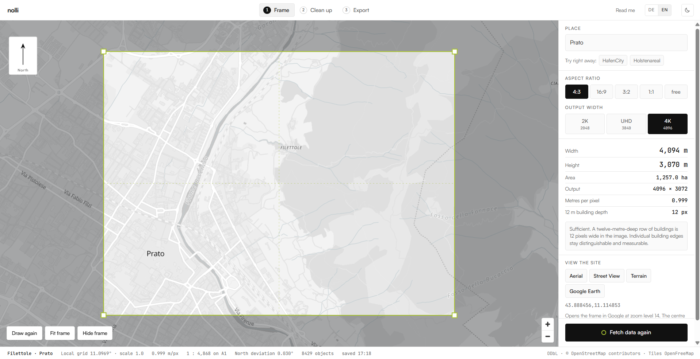
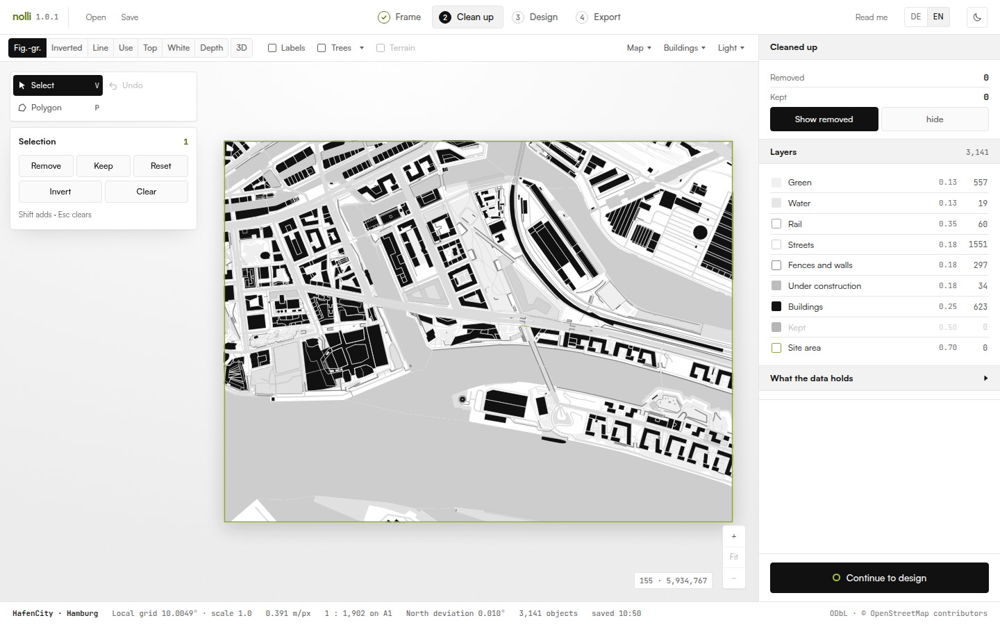
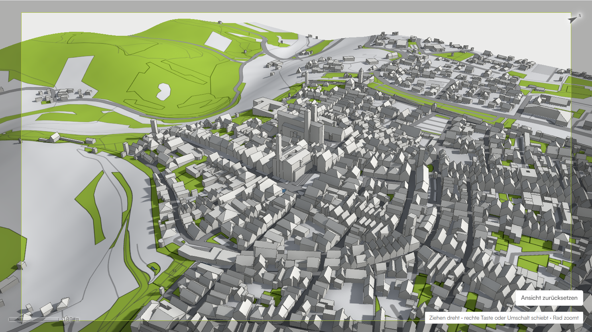
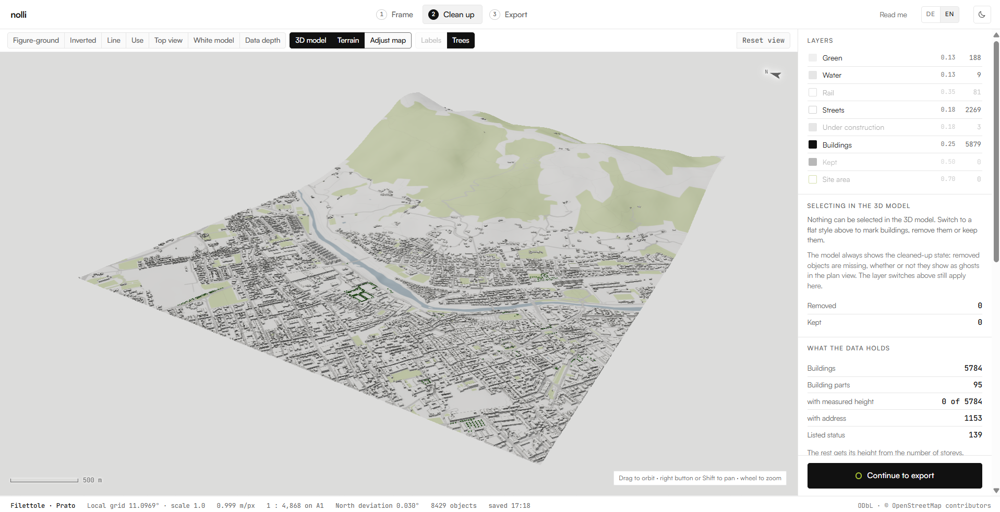
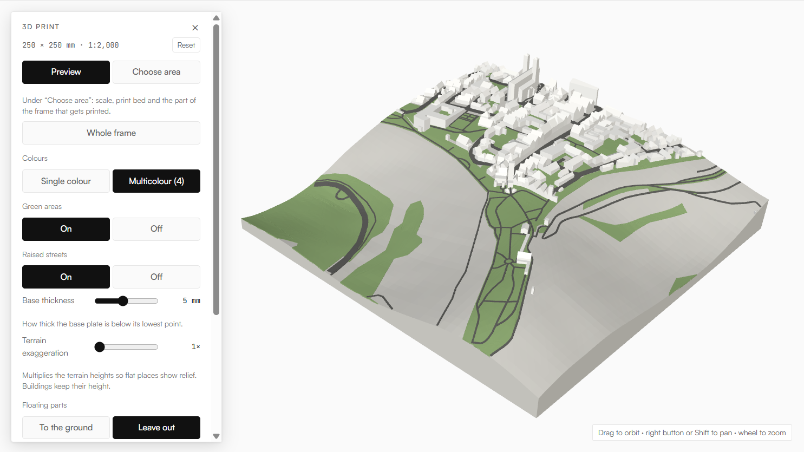
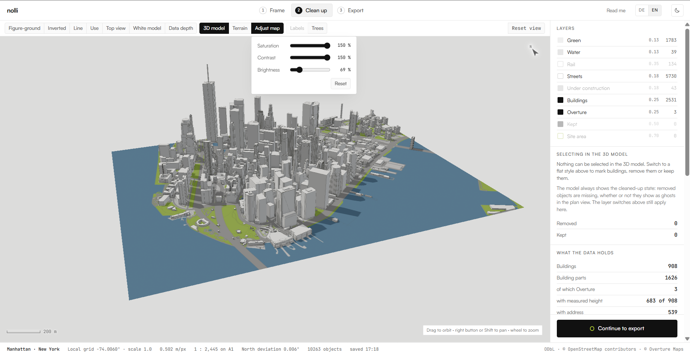
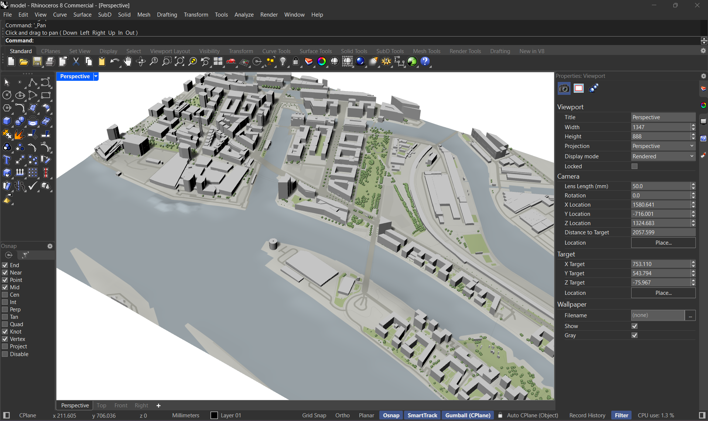

# Nolli

**Site context for urban design, straight from OpenStreetMap.** Pick a place,
set a frame, clean up the existing fabric, draw your own buildings into it, and take it out as figure-ground
plans, a CAD drawing, a 3D context model for Rhino, a file for the 3D printer,
and a data contract that every later tool can rely on.

**▶ Open the app: [zinssmeister.info/app/nolli](https://zinssmeister.info/app/nolli/)**
· Project page: [zinssmeister.info/nolli](https://zinssmeister.info/nolli)
· Companion tool for sun, shadow and irradiation on the model:
[Umbra](https://zinssmeister.info/app/umbra/) ([repository](https://github.com/yougop/umbra))
· By [Volker Zinssmeister](https://zinssmeister.info/)

Nolli runs entirely in the browser. There is no server, no account and no API
key: the page talks directly to OpenStreetMap (Overpass), the place search
(Photon), an open elevation model (AWS Terrain Tiles) and, on request,
Overture Maps.



## What you get

| Output | Contents |
|---|---|
| **Images** | Figure-ground, inverted, line, use, top view, white model, data depth, 3D model — up to 8192 px (8K), with a bare version of each (no buildings, no trees) to use as a ground texture. The 3D image has its own format, width and background, or a transparent one |
| **Plan as SVG** | The shown plan as vector paths, identical to the image: one layer per group (ground, green and water, streets, fences and walls, buildings, edges, trees, labels), A1 wide, for Illustrator, Affinity or Inkscape |
| **Drawing** | `drawing.dxf`: separate layers with pen widths (`N_BUILDINGS`, `N_STREETS`, `N_WATER`, …), labels, frame, contour lines when terrain is on. Cut at the frame, metres, origin at the lower-left corner. With terrain also `drawing_terrain.dxf`: the same plan lying on the terrain |
| **Model** | `model.3dm` for Rhino and `model.obj` with `model.mtl` and `model_texture.png`: buildings with their roofs, in greys by use class, cut cleanly at the frame; the ground textured with the top view, on the terrain or flat; tree crowns |
| **3D print** | `.3mf` or `.stl` in millimetres: a closed base plate with the buildings, raised streets, green areas and recessed water, as one object of five parts for a multicolour printer, or in one colour. Any part of the frame, at a scale or fitted to the bed, split into tiles if it is larger |
| **UCX package** | Everything above in one ZIP, e.g. `UCX_Prato_2026-11-05.zip`, plus all data as JSON, the parts of buildings beyond the frame (`model_outside.obj`, they still cast shadows into it) and a README in the interface language |
| **`frame.json`** | The data contract: frame, projection, scale, provenance, caveats, and the table of contents of the package |

## The four steps

| | |
|---|---|
| **1 · Frame** | Search a place or drag a rectangle. The aspect ratio snaps; width, height, area and metres per pixel update live. Nolli checks whether a 12 m deep row of buildings is still at least 12 px wide at the chosen output size — below that, building edges merge. Fetching can be cancelled. Once data is fetched, a dashed line shows how far it reaches: drag the frame smaller within it and nothing is fetched again. The map stays flat and north-up. |
| **2 · Clean up** | Clean-up only takes away; everything new is added in the Design step. The tools sit beside the sheet: select (V), polygon (P). Click objects or draw a polygon; a work window then offers remove, keep and reset. A click on a building part takes the whole house; Trees can be removed too. Removed objects stay visible as ghosts and are listed by ID in the contract. While drawing a polygon, the right mouse button takes back the last point and the view can still be panned. A site area clears everything inside and cuts streets at its boundary. Nolli removes buildings that cannot be buildings on its own, and offers to fill gaps from Overture (see below). |
| **3 · Design** | Draw your own buildings and green areas into the cleaned-up plan. The tools float beside the sheet, ordered by intent: **Select** (V) · draw new: **Building** (B), **Green** (G), **Trees** (T) · shape a building: **Raise** (U), **Courtyard** (A). Rectangle (R) or polygon (P) is a switch, not a tool; after a shape the tool returns to select, a double-click keeps it. Rectangles align with the nearest building edge (Alt: square to the sheet), polygons keep 45° steps with Shift; corners snap visibly, points and whole buildings also catch the building lines of neighbours (a dash-dotted guide shows which, two at once in their crossing; Alt switches it off), edges show their lengths. Below the tools a **work window** appears when there is something to do: storeys, storey height and use of the selection, length, depth and rotation of a rectangle, the options for planting. **A building grows by saying which area continues upwards.** *Raise* a drawn area by one storey or more: it stands on whatever is highest beneath it — a setback storey, a tower on a podium, a second step on the first. *+ Setback storey* does the usual in one click: one storey on top, set back 2.5 m all round, then adjusted with its handles. A *courtyard* is cut through all storeys, or only the ground floor for a passage. Raised areas move with the building when its storeys change, and the storeys stand as numbers in the plan (5, +1). The **section** is a true cut through the building, across or along, with the neighbours the line meets and the median height of the surroundings; drag an upper edge in it to change storeys. Upper parts are dashed in the plans and stand as bodies in the white model, 3D and the 3D print. Existing buildings under a new one are outlined in red and removed with one click. New buildings have their own colour or that of the existing ones; trees under them disappear. On the right: footprint, gross floor area, green area and — with a site area — site coverage and floor area ratio, calculated live. |
| **4 · Export** | One image, the drawing, the model, the 3D print, the data contract, or the complete package. New buildings go into all of them. |

**Ctrl+Z undoes and Ctrl+Y redoes in every step** — removing, keeping, the site area, planting and designing share one history. One rule holds in every step: the row above the sheet says what the sheet shows, the tools beside the sheet are where you act, the rail on the right is where you read, and the status line carries the frame. The row above the sheet is the same in steps 2 to 4: the styles, three switches (labels, trees, terrain) and the menus for map, buildings and light. Labels grow with the sheet, so a 4K image carries the same lettering as the screen, at any zoom. Each style keeps its own map, building and light settings — a desaturated 3D look no longer bends the figure-ground plan; a dot on a style shows it has its own values, and ↺ resets all.

**Trees** have one window, sorted by where they come from, each with an eye, a count and its own look (shape, size, height, variation, colour), one set for the plans and one for the 3D model:

- **Existing** — single trees from OpenStreetMap, conifers from `leaf_type` or genus as cones, plus trees set every 8 m along tree rows (`natural=tree_row`).
- **Woodland** — estimated trees in `landuse=forest` and `natural=wood`, broadleaf, conifer or mixed after `leaf_type`, with adjustable spacing.
- **Natural areas** — trunkless shrubs on scrub and heath, clumped by a soft noise into groups and clearings.
- **Added** — planted by hand with brush, lasso or single click, erasable; each stroke stays an area whose spacing, crown, variation and kind can be changed afterwards.

Estimated and added trees go into the model, OBJ and 3DM; `data/trees.json` lists existing and added trees with their `origin`.

**Fences and walls** (`barrier=fence/wall/hedge/city_wall/retaining_wall`) are their own layer, and natural areas (`natural=scrub/heath/grassland/wetland/wood`, orchards, vineyards) count as green in a slightly different tone.

**Project file.** **Save** writes everything — frame, data, clean-up, terrain, settings — into one `.nolli` file; **Open** reads it back without fetching. Saving again overwrites the open file; with Shift held it asks for a new name. (Chrome and Edge; other browsers download a copy.)




## The 3D model

The model is what Nolli knows, built as plainly as possible: a working model,
not a rendering.

- **Buildings as OpenStreetMap describes them.** Heights from `height`, else
  from the number of storeys, else 8 m — and every body says which. Parts with
  a lower edge (`min_height`, `building:min_level`) float where they belong:
  bridges between buildings, overhangs, the wheel of the London Eye. Where a
  building is described by its parts, the outline gives way to them.
- **Roofs from `roof:shape`:** gabled, hipped, skillion, pyramidal and dome,
  with `roof:height`, `roof:direction` and `roof:orientation`. Without a tag
  the roof is flat. The ridge follows the smallest rectangle around the
  footprint, so an L-shaped house gets one ridge instead of two.
- **Light like in Umbra.** Sky light cool from above and warm from the
  ground, a sun with direction and elevation, contact shadows that are sharp
  at the foot of a building and soften with distance, ambient occlusion
  (N8AO). Sun off gives an overcast sky. Brightness and a warm–cool light
  colour round it off. The sun also sets the shadows of the white model.
- **Map on the ground.** The top view lies on the ground at up to 8K;
  saturation, contrast and brightness, and the weight of the map's lines, are
  set under **Map**. A grey, desaturated ground gives a plain context in Rhino.



### Terrain

Switch on **Terrain** in the 3D model. Nolli fetches heights for the frame
plus a 150 m margin from the
[AWS Terrain Tiles](https://registry.opendata.aws/terrain-tiles/) and puts
every building on the lowest terrain height under its footprint. The terrain
mesh goes into the model, contour lines into the drawing, the raster into
`data/terrain.json`. Water areas from OpenStreetMap are laid flat, at the
lower fifth of the heights along their shore: over water the elevation models
measure noise, not a surface.

**Know the limits.** The tiles combine several elevation models; in Europe it
is mostly EU-DEM at about 25 m, elsewhere mostly SRTM at about 30 m. Most of
them measure the surface, not the bare ground. That is good for slope, valley
form and river position at masterplan scale — not for embankments, quay walls
or steps. For more accuracy, bring in an official terrain model (see below).
Terrain is off by default; then everything stands on z = 0.



## 3D print

**3D print** below **Export image** opens a panel on the left.

- **Size:** fitted to the bed, or a scale from 1:500 to 1:5,000, the bed size,
  and the area in millimetres. On opening, Nolli proposes a bed-sized area at
  the coarsest scale at which fewer than 5 % of the buildings are too narrow
  to print. **Choose area** shows the frame as a plan with a rectangle: drag
  it, pull its corners, zoom with the wheel, or move it with the arrow keys.
  Format presets (free, 1:1, 4:3, 3:2, 16:9, portrait or landscape) hold
  their ratio while the corners are pulled. Centre lines help to find the
  place, and the tile seams are drawn in.
- **Tiles.** If the area is larger than the bed, Nolli splits it into equal
  tiles. Up to 36 tiles go into one 3MF, each tile an object on the plate
  grid of Bambu Studio and OrcaSlicer; select all and **Arrange** (A) puts
  each on its own plate. Beyond 36, and for STL, one file per tile in a ZIP.
  For multicolour prints keep the bed at about 200 mm on the X1 Carbon to
  leave room for the prime tower.
- **Preview** shows the print on the stage, all tiles in place with their
  name and size, before a file is written. **Problems only** fades
  everything except the parts that will not print.
- **Multicolour** writes one object of five parts — base, buildings, streets,
  green, water — so each part gets its own spool. With the four slots of a
  Bambu Lab AMS, give base and buildings the same one. **Single colour**
  writes one body; streets stand 0.4 mm proud of the plate and water lies
  0.8 mm below it, so both still read.
- **Base thickness** below the lowest point of the area, **terrain
  exaggeration** for flat places (only the ground, never the buildings),
  floating parts **to the ground**, **kept** at their height (the slicer adds
  supports) or **left out**.
- **Parts too small** are counted, shown in red in the preview and in the
  area, and kept or left out: cut pieces at a tile seam or the edge that are
  narrower than 2 mm or tall and thin, slender towers, masts and slabs, and
  buildings narrower than 0.8 mm. A part that leans on a solid neighbour
  prints with it and counts only by what sticks out above it. Against cut
  pieces, nudge the area until no seam clips a building.
- **Leave out by hand:** in **Choose area**, a click on a building leaves it
  out of the print only; image, Rhino and package keep it.

Every part is a closed solid in millimetres; buildings sit half a millimetre
into the plate so they fuse with it. A single tile lies centred on the bed of
the X1 Carbon. Bambu Studio reports “invalid configuration, only geometry is loaded” for every
3MF it did not write itself — that is expected; printer settings belong in the
slicer.



## Gaps in OpenStreetMap: Overture

OpenStreetMap is excellent in most European cities and thin in many others.
In Upper Saddle River, New Jersey, it has 13 buildings along 16 km of
residential streets. Nolli notices this — many street kilometres, few
buildings — and offers to add buildings from
[Overture Maps](https://overturemaps.org/), which merges OpenStreetMap with
footprints traced from aerial imagery by Microsoft, Google and others. In
Upper Saddle River that turns 13 buildings into about 630.

- **Only what is missing.** Overture buildings that come from OpenStreetMap
  are skipped, and so is every one whose centre lies inside an OSM building.
  Fresh Overpass data always wins.
- **Its own layer.** Added buildings sit on the layer `Overture` and can be
  switched off; then they are left out of every output.
- **Marked in the contract** with `origin: "overture"`, `overture_id` and
  `geometry_source`; their heights count as `from_imagery`.
- **Places (optional):** shops, restaurants, schools and services into
  `data/places.json`, open places with confidence ≥ 0.5, without phone
  numbers, e-mail addresses or social media profiles.

**Implausible buildings.** Errors in OpenStreetMap can be large: in Mariental,
Namibia, a residential area of 119 ha was once tagged as one building and
covered 3,700 real houses. Nolli removes buildings that contain ten or more
others, says so, links the object and offers to keep it. Every case is listed
in `frame.json` under `implausible_buildings`.



## Using the package in Rhino or QGIS

The model uses a transverse Mercator projection centred on the site (scale 1,
grid north = true north at the centre). The exact definition is in
`frame.json` under `grid.proj4`.

- **Rhino:** open `model.3dm`. Buildings with flat roofs come as extrusions,
  those with roofs or courtyards as meshes, on layers by use class
  (`N_BUILDINGS::residential` …). The drawing's curves sit on their DXF
  layers, the map is embedded on the ground, and every body carries UserText:
  `body_id`, `osm_id`, height and its source, use class, material, roof
  shape. Outlines replaced by their parts and parts beyond the frame sit on
  hidden layers.
- **Rhino via OBJ:** import `model.obj` in metres; material and texture come
  with it. `drawing.dxf` lines up with it and stays flat on purpose, so its
  curves can still be hatched and extruded; `drawing_terrain.dxf` already lies
  on the terrain.
- **QGIS and other data:** create a custom coordinate system from
  `grid.proj4`, reproject your data into it and move it by −`bbox_grid[0]`,
  −`bbox_grid[1]`. The package README spells out the numbers. This is also how
  to replace the terrain with an official model, for example regional LiDAR.
  The frame corners are also given in UTM (`utm.epsg`, `utm.bbox`).



## Versions

Nolli is numbered since **1.0.0** (9 November 2026, with the Design step). The first number changes when the data contract breaks, the second with new features, the third with fixes. The version stands next to the logo — its tooltip adds the build (the git commit) — and in every package as `provenance.generated.release`, next to the build in `provenance.generated.version`.

## Data contract: UCX

The package format is called UCX, Urban Context Exchange. Nolli writes it;
other tools of the chain (Umbra, later Pons in Rhino) read it or carry it on.
`frame.json` starts with `"contract": "ucx", "contract_version": 2`. Field,
file, object and layer names are English; the mapping from the earlier German
names lives in [`werkzeug/src/lib/vertrag.ts`](werkzeug/src/lib/vertrag.ts).

- **The data is authoritative, the geometry is derived.** `body_id`, height,
  lower edge, roof, material and origin are defined in `data/bodies.json`;
  `model.obj`, `model.3dm`, the drawings and the print are generated from it.
- **Every number carries its origin** — measured, from storeys, from aerial
  imagery, or the 8 m default.
- **An empty caveat list is a statement.** `caveats` names what the model
  simplifies (`roofs_flat` or `roofs_partial`, `terrain_flat` or
  `terrain_coarse`, `buildings_from_imagery`, `buildings_implausible`); a
  missing list means “assume the worst”.
- **Every package knows where it comes from.** `provenance.generated` names
  the tool, its build and the time; later tools append to `provenance.edits`.
- **Time is local:** `time_zone` names the IANA zone at the frame centre.
- **Designed is not surveyed.** Buildings drawn in Nolli carry `origin: design`,
  `source: design` and `storey_height_m` in `data/bodies.json` and the `design`
  material; they are named `new_…` in `model.obj`, lie on `N_NEW` in the
  drawing and on the layer `new` in `model.3dm`, and `frame.json` lists them
  under `new`. A building with setbacks, cut-outs or extra volumes is written
  as one body per storey band with `min_height_m`, all carrying the same
  `design_id`. Designed green areas lie on `N_NEW_GREEN`, are listed under
  `new_green` and counted as `new_green` in `areas_m2`.
- **Additions only.** New fields such as `min_height_m`, `replaced_by_parts`,
  `roof_shape` and `roof_height_m` are added without breaking older readers.

## Language

The interface switches between German and English (top right); the choice is
remembered. Package contents are always in English; only the package README
follows the interface language.

## Running it

```bash
cd werkzeug
npm install
npm run dev -- --open          # http://localhost:5173
```

To publish, build a static site and put the contents of `werkzeug/build/` on
any web server that serves files and uses `200.html` as fallback:

```bash
cd werkzeug
npm run build
```

No Node, no database and no environment variables are needed at runtime. Each
visitor talks to Overpass from their own address, as its usage policy intends
for occasional use. Overpass is a donated service: Nolli limits a frame to
40 km² and waits between requests.

## Checks

Manual scripts in `werkzeug/pruefung/`, run against a preview on port 5185
(`npm run build`, then `npx vite preview --port 5185` from `werkzeug/`):

| Script | Checks |
|---|---|
| `npm run check` | Type checking (svelte-check) |
| `pruefung/paket.mjs <dir>` | Builds the model ZIP and the complete package for the HafenCity example |
| `pruefung/vertrag.mjs` | Contract name tables are reversible |
| `pruefung/sprache.mjs <dir>` | Walks the English interface and reports German leftovers |
| `pruefung/gelaende.mjs <dir> [place]` | Builds a package with terrain at a real place. Uses live data |
| `pruefung/entwurf.mjs <dir> [w] [h]` | Plays through clean-up and design at a window size (default 1280×720), saves images and reports whether the work window or the rail scrolls |
| `pruefung/leiste.mjs` | Lists the styles and switches the interface offers, read from the source |
| `pruefung/stand.mjs live\|merken\|seither` | Compares the published app with the local build, records a delivery |

## Repository layout

```
werkzeug/                   the Nolli web app (SvelteKit, static build)
  src/lib/geo/              projection, frame, terrain, coast
  src/lib/export/           DXF, OBJ, 3DM (rhino3dm) and 3D print (3MF, STL)
  src/lib/dach.ts           roof shapes
  src/lib/raum.ts           building bodies and edges for the 3D view
  src/lib/vertrag.ts        data contract name tables
  src/lib/sprache.svelte.ts German and English interface texts
  pruefung/                 check scripts
docs/                       screenshots for this README
DESIGN.md                   design rules of the interface
```

The code and its comments are written in German; the interface and the
package are bilingual.

## License

The code is licensed under the [GNU Affero General Public License v3.0](LICENSE)
or later. You may use, change and pass it on; if you run a changed version as a
website, you must offer its source code to its users. What Nolli produces —
images, drawings, models, prints, packages — is not covered by this license; it
carries the licenses of its data sources below.

## Data sources and attribution

- **OpenStreetMap** via Overpass — © OpenStreetMap contributors, ODbL. The
  attribution belongs with every output you pass on, a printed model included.
- **Terrain** — AWS Terrain Tiles (Tilezen). Attribution per source model:
  [tilezen/joerd attribution](https://github.com/tilezen/joerd/blob/master/docs/attribution.md).
  EU-DEM: produced using Copernicus data and information funded by the
  European Union. SRTM: NASA.
- **Overture Maps** (only if added) — buildings under ODbL; footprints from
  Microsoft ML Building Footprints (ODbL), Google Open Buildings and Esri
  (CC BY 4.0). Places under CDLA Permissive 2.0, Foursquare data under
  Apache 2.0. The package names the sources actually used.
- **Base map** — OpenFreeMap. **Place search** — Photon by Komoot.
- **Libraries** — three.js, N8AO, rhino3dm, earcut, fflate, MapLibre GL.
