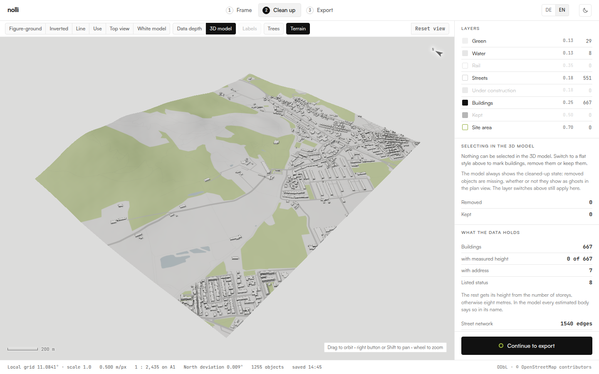
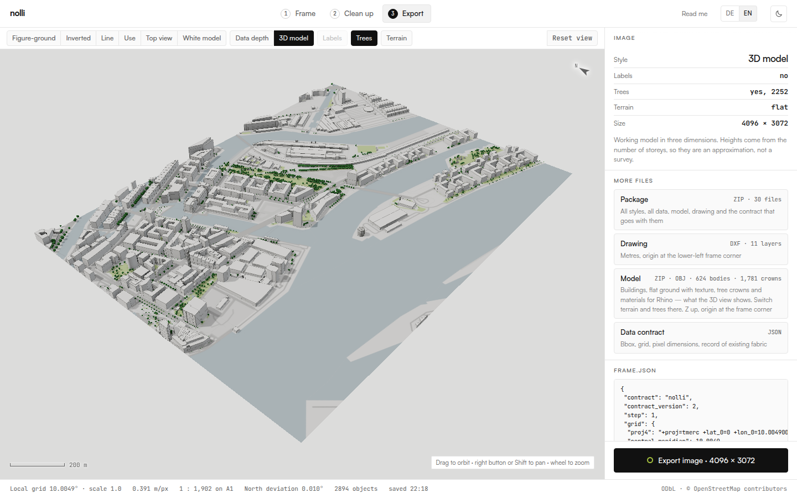
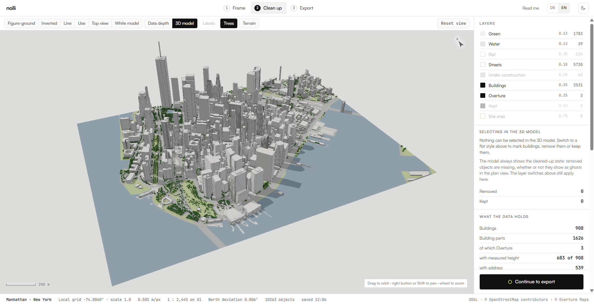
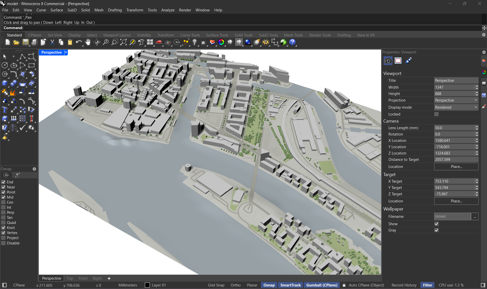

# Nolli

**Site context for urban design, straight from OpenStreetMap.** Pick a place,
set a frame, clean up the existing fabric, and export figure-ground plans, a
CAD drawing, a 3D context model with terrain, and a data contract that every
later tool can rely on.

**▶ Open the app: [zinssmeister.info/app/nolli](https://zinssmeister.info/app/nolli/)**
· Project page: [zinssmeister.info/nolli](https://zinssmeister.info/nolli)
· Companion tool for sun, irradiation and wind on the model:
[Umbra](https://zinssmeister.info/app/umbra/) ([repository](https://github.com/yougop/umbra))
· By [Volker Zinssmeister](https://zinssmeister.info/)

Nolli runs entirely in the browser. There is no server, no account and no API
key: the page talks directly to OpenStreetMap (Overpass), the place search
(Photon), an open elevation model (AWS Terrain Tiles) and, on request,
Overture Maps.



## What you get

| Output | Contents |
|---|---|
| **Images** | Figure-ground, inverted, line, use, top view, white model, data depth, 3D view — up to 4096 px, with a bare version (no buildings, no trees) of each to use as a ground texture |
| **`drawing.dxf`** | Separate layers with pen widths (`N_BUILDINGS`, `N_STREETS`, `N_WATER`, …), labels, frame, and contour lines when terrain is on. Metres, origin at the lower-left frame corner |
| **Model (ZIP)** | `model.obj`, `model.mtl` and `model_texture.png`, ready for Rhino: extruded buildings with hard edges, cut cleanly at the frame edge; the ground textured with the top view, on the terrain or flat; tree crowns as one object `trees`. It contains what the 3D view shows — switch terrain and trees there |
| **Package (ZIP)** | Everything above plus `model_outside.obj`, the parts of buildings beyond the frame edge, which still cast shadows into it |
| **`frame.json`** | The data contract: frame, projection, scale, provenance, caveats, and a table of contents of the package |
| **`data/*.json`** | Everything OpenStreetMap knows inside the frame: buildings with height and origin of the height, street network as a graph, points of interest, stops and lines, land use, trees, terrain raster. If added: buildings from Overture (marked as such) and `data/places.json` |
| **`README.md`** | Written into every package, in the interface language |

## The three steps

| | |
|---|---|
| **1 · Frame** | Search a place or drag a rectangle. The aspect ratio snaps; width, height, area and metres per pixel update live. Nolli checks whether a 12 m deep row of buildings is still at least 12 px wide at the chosen output size — below that, building edges merge. The status line names the place under the frame, and follows it when you move it. Fetching the data can be cancelled. |
| **2 · Clean up** | Click objects or draw a polygon to remove them or keep them. Removed objects stay visible as ghosts and are listed by ID in the contract. Buildings that cannot be buildings — one containing ten or more others — are removed by Nolli itself, with a note and a button to keep them (see below). A site area clears everything inside and cuts streets at its boundary. If OpenStreetMap has streets but hardly any buildings, Nolli says so and offers to fill the gap from Overture. |
| **3 · Export** | One image, the drawing, the model, the data contract, or the complete package. |


## Terrain

Switch on **Terrain** in the 3D model. Nolli fetches heights for the frame
plus a 150 m margin from the [AWS Terrain Tiles](https://registry.opendata.aws/terrain-tiles/)
(Terrarium format) and then:

- puts every building on the lowest terrain height under its footprint, so it
  sits into the slope instead of floating above it;
- adds a terrain mesh (`terrain`, 10 m grid) to `model.obj`, heights in metres
  above sea level, textured with the top view without buildings;
- adds contour lines to `drawing.dxf` on `N_CONTOUR` and `N_CONTOUR_MAJOR`,
  each at its height, with an interval chosen from the height range;
- writes the raster to `data/terrain.json` and records the source models in
  the contract.

**Know the limits.** The tiles combine several elevation models; in Europe it
is mostly EU-DEM at about 25 m, elsewhere mostly SRTM at about 30 m. Most of
them measure the surface, not the bare ground, so dense buildings and forest
raise it slightly. That is good for slope, valley form and river position at
masterplan scale — not for embankments, quay walls or steps. For more
accuracy, bring in an official terrain model (see below).

Terrain is off by default. Then everything stands on z = 0 and the contract
says so (`terrain_flat`).



## Gaps in OpenStreetMap: Overture

OpenStreetMap is excellent in most European cities and thin in many others.
In Upper Saddle River, New Jersey, it has 13 buildings along 16 km of
residential streets. Nolli notices this — many street kilometres, few
buildings — and offers to add buildings from
[Overture Maps](https://overturemaps.org/), which merges OpenStreetMap with
building footprints traced from aerial imagery by Microsoft, Google and
others. In Upper Saddle River that turns 13 buildings into about 630.

- **Only what is missing.** Overture buildings that come from OpenStreetMap
  are skipped, and so is every one whose centre lies inside an OSM building or
  construction site. Fresh Overpass data always wins.
- **Its own layer.** Added buildings sit on the layer `Overture` (DXF
  `N_OVERTURE`) and can be switched off; then they are left out of every
  output, images, drawing, model and contract alike. In the data depth view
  they have their own colour.
- **Marked in the contract.** Each body says `origin: "overture"` with its
  `overture_id` and `geometry_source`; their heights count as
  `from_imagery`, and the caveat `buildings_from_imagery` is set. The
  `overture` block names the release and the attribution the sources require.
- **Places (optional).** One more button fetches Overture places — shops,
  restaurants, schools, services — into `data/places.json`, filtered to open
  places with confidence ≥ 0.5. Phone numbers, e-mail addresses and social
  media profiles are left out. They are not drawn in the plan; they are there
  for site analysis further down the chain.

Overture is fetched only on request, tile by tile straight from its public
PMTiles archive, with no server in between.

**Implausible buildings.** Errors in OpenStreetMap can be large. In
Mariental, Namibia, a residential area of 119 ha was retagged as a single
building in October 2026 and covered 3,700 real houses. After every fetch
Nolli looks for buildings that contain ten or more other buildings, removes
them for now and says so, with a link to the object and a button to keep it
after all. Buildings over 20 ha that contain nothing are only flagged; the
largest real halls come close to that.
The package says so: every flagged building is listed in `frame.json` under
`implausible_buildings` (ID, area, buildings inside, removed or kept, OSM link),
with the caveat `buildings_implausible`, so a removal by Nolli can be told
apart from one made by hand.



## Using the package in Rhino or QGIS

The model uses a transverse Mercator projection centred on the site (scale 1,
grid north = true north at the centre). The exact definition is in
`frame.json` under `grid.proj4`.

- **Rhino:** unpack the model ZIP and import `model.obj` in metres; material
  and texture come with it, nothing to map. `drawing.dxf` lines up with it.
  The drawing stays flat on purpose, so its curves can still be hatched,
  extruded and capped; to put single curves on the slope, use `_Project` or
  `_Pull` onto the terrain mesh. Images fit exactly onto the frame from 0/0
  to width/height.

- **Other data (QGIS):** create a custom coordinate system from `grid.proj4`,
  reproject your data into it and move it by −`bbox_grid[0]`, −`bbox_grid[1]`.
  The package README spells out the numbers. This is also how to replace the
  terrain with an official model, for example regional LiDAR.
- The frame corners are also given in UTM (`utm.epsg`, `utm.bbox`) for joining
  official datasets.



## Data contract (v2)

`frame.json` starts with `"contract": "nolli", "contract_version": 2`. Field,
file, object and layer names are English. The mapping from the earlier German
names (v1) lives in one place, [`werkzeug/src/lib/vertrag.ts`](werkzeug/src/lib/vertrag.ts),
so tools can read both versions.

Principles the contract follows:

- **Every number carries its origin** — measured, computed or estimated.
  Building heights say whether they come from a `height` tag, from the number
  of storeys, from aerial imagery (Overture), or from the 8 m default.
- **An empty caveat list is a statement.** `caveats` lists what the model
  simplifies (`roofs_flat`, `terrain_flat` / `terrain_coarse`,
  `buildings_from_imagery`, `buildings_implausible`); a missing list
  means "assume the worst".
- **Time is local.** `time_zone` names the IANA time zone at the frame
  centre (e.g. `America/New_York`), looked up offline; `null` if unknown. No
  fixed offset: daylight saving is for the reading tool to apply per date.
- **The contract never contradicts itself.** All dimensions derive from the
  rounded frame corners; `width_m / pixel_width` equals `meters_per_pixel`
  exactly.

## Language

The interface switches between German and English (top right). The choice is
remembered; otherwise the browser language decides. Package contents are
always in contract v2 English; only the package README follows the interface
language.

## Running it

```bash
cd werkzeug
npm install
npm run dev -- --open          # http://localhost:5173
```

To publish, build a static site and put the contents of `werkzeug/build/` on
any web server that can serve files and use `200.html` as fallback:

```bash
cd werkzeug
npm run build
```

No Node, no database and no environment variables are needed at runtime. Each
visitor talks to Overpass from their own address, as Overpass's usage policy
intends for occasional use. Overpass is a donated service: Nolli limits a
frame to 40 km² and waits between requests.

## Checks

Manual scripts in `werkzeug/pruefung/`, run against `vite preview` on port
5185 (`npm run build && npx vite preview --port 5185`):

| Script | Checks |
|---|---|
| `npm run check` | Type checking (svelte-check) |
| `pruefung/paket.mjs <dir>` | Builds the model ZIP and the complete package for the HafenCity example |
| `pruefung/vertrag.mjs <v1> <v2> [umbra.html]` | Contract tables are reversible; a v2 package mapped back equals a v1 package; a downstream tool's copy of the table matches |
| `pruefung/sprache.mjs <dir>` | Walks the English interface and reports German leftovers |
| `pruefung/gelaende.mjs <dir> [place]` | Builds a package with terrain at a real place (default: Galceti, Prato). Uses live data |
| `pruefung/leiste.mjs` | Lists the styles and switches the interface offers, read from the source |
| `pruefung/stand.mjs live\|merken\|seither` | Compares the published app with the local build, records a delivery, lists what changed since |

## Repository layout

```
werkzeug/              the Nolli web app (SvelteKit, static build)
  src/lib/geo/         projection, frame, terrain
  src/lib/export/      DXF, OBJ and tree crown writers
  src/lib/vertrag.ts   data contract v2 name tables
  src/lib/sprache.svelte.ts   German and English interface texts
  pruefung/            check scripts
docs/                  screenshots for this README
DESIGN.md              design rules of the interface (colours, type, layout)
```

The code and comments are written in German; the interface and the package
are bilingual.

## License

The code is licensed under the [GNU Affero General Public License v3.0](LICENSE)
or later. You may use, change and pass it on; if you run a changed version as a
website, you must offer its source code to its users. What Nolli produces —
images, drawings, models, packages — is not covered by this license; it
carries the licenses of its data sources below.

## Data sources and attribution

- **OpenStreetMap** via Overpass — © OpenStreetMap contributors, ODbL. The
  attribution belongs with every output you pass on.
- **Terrain** — AWS Terrain Tiles (Tilezen). Attribution per source model:
  [tilezen/joerd attribution](https://github.com/tilezen/joerd/blob/master/docs/attribution.md).
  EU-DEM: produced using Copernicus data and information funded by the
  European Union. SRTM: NASA.
- **Overture Maps** (only if added) — buildings under ODbL; footprints from
  Microsoft ML Building Footprints (ODbL), Google Open Buildings and Esri
  (CC BY 4.0). Places under CDLA Permissive 2.0, Foursquare data under
  Apache 2.0. The package names the sources actually used.
- **Base map** — OpenFreeMap. **Place search** — Photon by Komoot.
