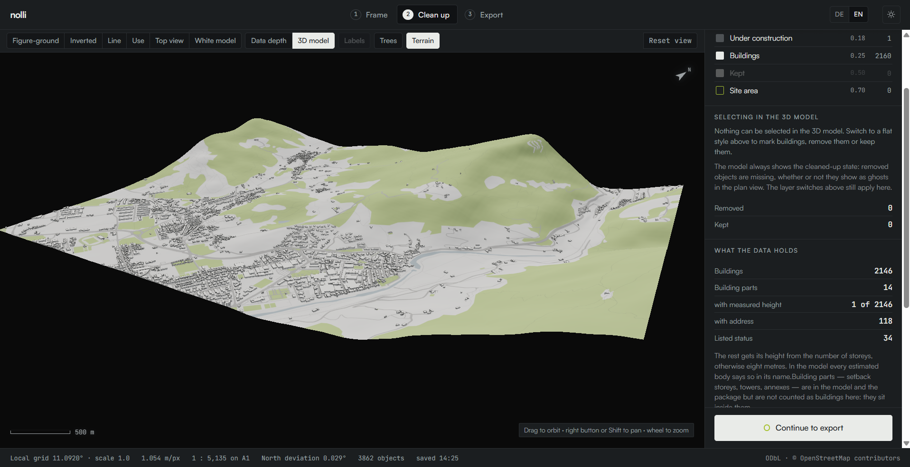
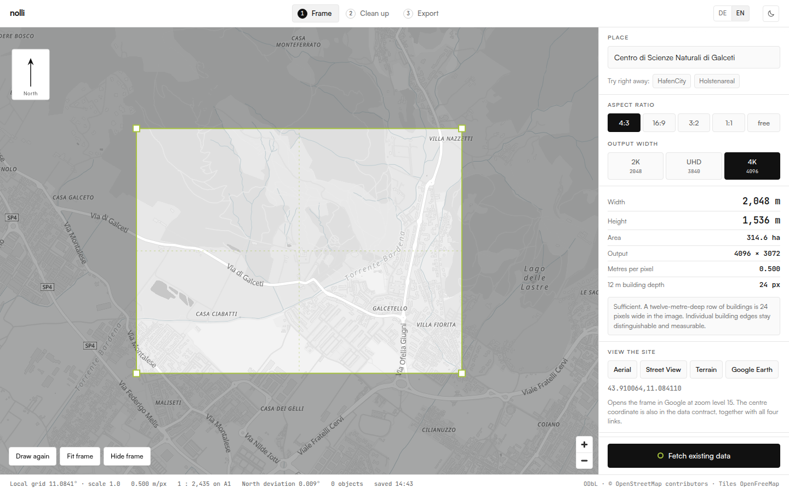
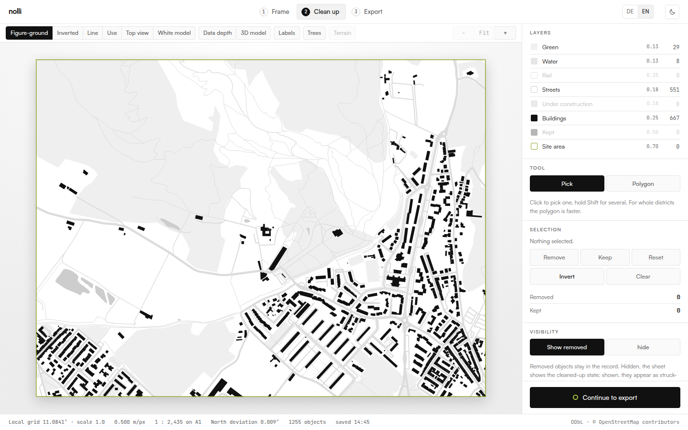
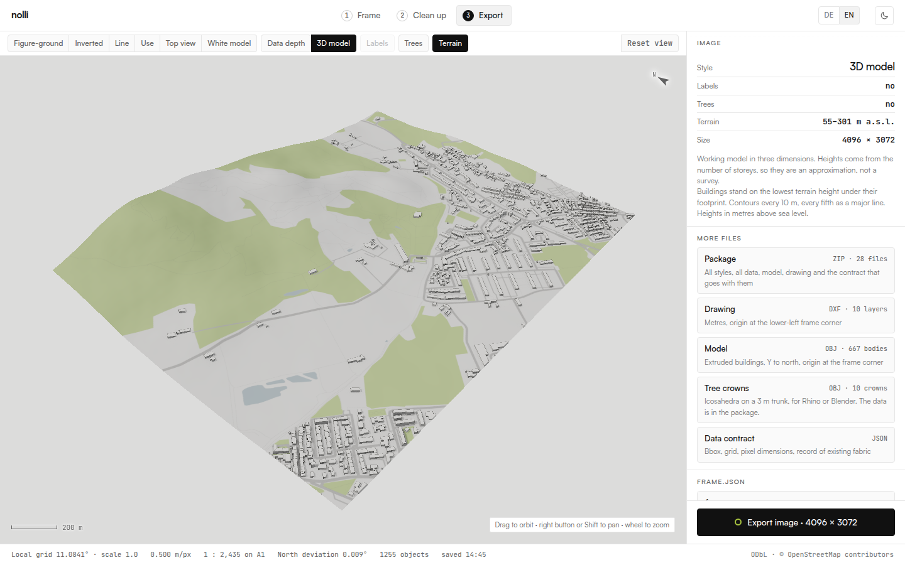

# Nolli

**Site context for urban design, straight from OpenStreetMap.** Pick a place,
set a frame, clean up the existing fabric, and export figure-ground plans, a
CAD drawing, a 3D context model with terrain, and a data contract that every
later tool can rely on.

**▶ Open the app: [zinssmeister.info/app/nolli](https://zinssmeister.info/app/nolli/)**
· Project page: [zinssmeister.info/nolli](https://zinssmeister.info/nolli)
· Companion tool for sun, irradiation and wind on the model:
[Umbra](https://zinssmeister.info/app/umbra/) ([repository](https://github.com/yougop/umbra))
· By [Volker Zinssmeister](https://zinssmeister.info/)

Nolli runs entirely in the browser. There is no server, no account and no API
key: the page talks directly to OpenStreetMap (Overpass), the place search
(Photon) and an open elevation model (AWS Terrain Tiles).



## What you get

| Output | Contents |
|---|---|
| **Images** | Figure-ground, inverted, line, use, top view, white model, data depth, 3D view — up to 4096 px, with a bare version (no buildings, no trees) of each to use as a ground texture |
| **`drawing.dxf`** | Separate layers with pen widths (`N_BUILDINGS`, `N_STREETS`, `N_WATER`, …), labels, frame, and contour lines when terrain is on. Metres, origin at the lower-left frame corner |
| **Model (ZIP)** | `model.obj` with extruded buildings, cut cleanly at the frame edge and flagged where the height is estimated, plus a ground mesh textured with the top view (on the terrain when it is on, otherwise flat). `model.mtl` and `model_texture.png` come with it, so Rhino opens it textured. `model_outside.obj` holds what reaches beyond the frame, `trees.obj` the tree crowns |
| **`frame.json`** | The data contract: frame, projection, scale, provenance, caveats, and a table of contents of the package |
| **`data/*.json`** | Everything OpenStreetMap knows inside the frame: buildings with height and origin of the height, street network as a graph, points of interest, stops and lines, land use, trees, terrain raster |
| **`README.md`** | Written into every package, in the interface language |

## The three steps

| | |
|---|---|
| **1 · Frame** | Search a place or drag a rectangle. The aspect ratio snaps; width, height, area and metres per pixel update live. Nolli checks whether a 12 m deep row of buildings is still at least 12 px wide at the chosen output size — below that, building edges merge. |
| **2 · Clean up** | Click objects or draw a polygon to remove them or keep them. Removed objects stay visible as ghosts and are listed by ID in the contract. A site area clears everything inside and cuts streets at its boundary. |
| **3 · Export** | One image, single files, or the complete package as a ZIP. |




## Terrain

Switch on **Terrain** in the 3D model. Nolli fetches heights for the frame
plus a 150 m margin from the [AWS Terrain Tiles](https://registry.opendata.aws/terrain-tiles/)
(Terrarium format) and then:

- puts every building on the lowest terrain height under its footprint, so it
  sits into the slope instead of floating above it;
- adds a terrain mesh (`terrain`, 10 m grid) to `model.obj`, heights in metres
  above sea level, textured with the top view without buildings;
- adds contour lines to `drawing.dxf` on `N_CONTOUR` and `N_CONTOUR_MAJOR`,
  each at its height, with an interval chosen from the height range;
- writes the raster to `data/terrain.json` and records the source models in
  the contract.

**Know the limits.** The tiles combine several elevation models; in Europe it
is mostly EU-DEM at about 25 m, elsewhere mostly SRTM at about 30 m. Most of
them measure the surface, not the bare ground, so dense buildings and forest
raise it slightly. That is good for slope, valley form and river position at
masterplan scale — not for embankments, quay walls or steps. For more
accuracy, bring in an official terrain model (see below).

Terrain is off by default. Then everything stands on z = 0 and the contract
says so (`terrain_flat`).



## Using the package in Rhino or QGIS

The model uses a transverse Mercator projection centred on the site (scale 1,
grid north = true north at the centre). The exact definition is in
`frame.json` under `grid.proj4`.

- **Rhino:** import `model.obj` and `drawing.dxf` in metres; they line up.
  Keep `model.mtl` and `model_texture.png` next to the OBJ. The drawing stays
  flat on purpose, so its curves can still be hatched and extruded. Images fit
  exactly onto the frame from 0/0 to width/height.
- **Other data (QGIS):** create a custom coordinate system from `grid.proj4`,
  reproject your data into it and move it by −`bbox_grid[0]`, −`bbox_grid[1]`.
  The package README spells out the numbers. This is also how to replace the
  terrain with an official model, for example regional LiDAR.
- The frame corners are also given in UTM (`utm.epsg`, `utm.bbox`) for joining
  official datasets.

## Data contract (v2)

`frame.json` starts with `"contract": "nolli", "contract_version": 2`. Field,
file, object and layer names are English. The mapping from the earlier German
names (v1) lives in one place, [`werkzeug/src/lib/vertrag.ts`](werkzeug/src/lib/vertrag.ts),
so tools can read both versions.

Principles the contract follows:

- **Every number carries its origin** — measured, computed or estimated.
  Building heights say whether they come from a `height` tag, from the number
  of storeys, or from the 8 m default.
- **An empty caveat list is a statement.** `caveats` lists what the model
  simplifies (`roofs_flat`, `terrain_flat` / `terrain_coarse`); a missing list
  means "assume the worst".
- **The contract never contradicts itself.** All dimensions derive from the
  rounded frame corners; `width_m / pixel_width` equals `meters_per_pixel`
  exactly.

## Language

The interface switches between German and English (top right). The choice is
remembered; otherwise the browser language decides. Package contents are
always in contract v2 English; only the package README follows the interface
language.

## Running it

```bash
cd werkzeug
npm install
npm run dev -- --open          # http://localhost:5173
```

To publish, build a static site and put the contents of `werkzeug/build/` on
any web server that can serve files and use `200.html` as fallback:

```bash
cd werkzeug
npm run build
```

No Node, no database and no environment variables are needed at runtime. Each
visitor talks to Overpass from their own address, as Overpass's usage policy
intends for occasional use. Overpass is a donated service: Nolli limits a
frame to 40 km² and waits between requests.

## Checks

Manual scripts in `werkzeug/pruefung/`, run against `vite preview` on port
5185 (`npm run build && npx vite preview --port 5185`):

| Script | Checks |
|---|---|
| `npm run check` | Type checking (svelte-check) |
| `pruefung/paket.mjs <dir>` | Builds a complete package for the HafenCity example |
| `pruefung/vertrag.mjs <v1> <v2> [umbra.html]` | Contract tables are reversible; a v2 package mapped back equals a v1 package; a downstream tool's copy of the table matches |
| `pruefung/sprache.mjs <dir>` | Walks the English interface and reports German leftovers |
| `pruefung/gelaende.mjs <dir> [place]` | Builds a package with terrain at a real place (default: Galceti, Prato). Uses live data |

## Repository layout

```
werkzeug/              the Nolli web app (SvelteKit, static build)
  src/lib/geo/         projection, frame, terrain
  src/lib/export/      DXF, OBJ and tree crown writers
  src/lib/vertrag.ts   data contract v2 name tables
  src/lib/sprache.svelte.ts   German and English interface texts
  pruefung/            check scripts
docs/                  screenshots for this README
DESIGN.md              design rules of the interface (colours, type, layout)
```

The code and comments are written in German; the interface and the package
are bilingual.

## Data sources and attribution

- **OpenStreetMap** via Overpass — © OpenStreetMap contributors, ODbL. The
  attribution belongs with every output you pass on.
- **Terrain** — AWS Terrain Tiles (Tilezen). Attribution per source model:
  [tilezen/joerd attribution](https://github.com/tilezen/joerd/blob/master/docs/attribution.md).
  EU-DEM: produced using Copernicus data and information funded by the
  European Union. SRTM: NASA.
- **Base map** — OpenFreeMap. **Place search** — Photon by Komoot.
